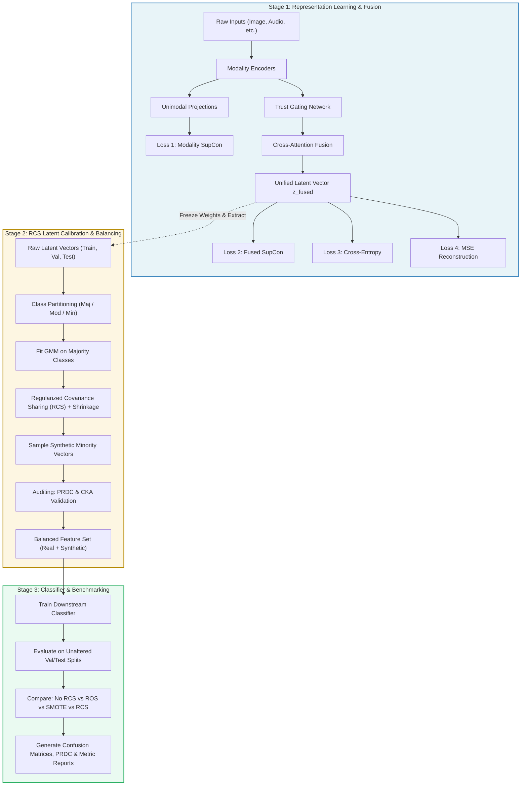

# Multimodal Representation Learning with Regularized Covariance Sharing (RCS)
## Comprehensive Technical Documentation & End-to-End Workflow Guide

> **Target Audience:** New Team Members, Research Collaborators, and Engineers.  
> **Repository:** `Modality-Bias` / `Multimodal-RCS`  
> **Purpose:** This document provides a complete, self-contained, and rigorous explanation of the research problem statement, theoretical assumptions, end-to-end mathematical formulation, modular architectural components, multi-stage loss landscape, and full execution workflow with concrete numerical examples.

---

## Table of Contents
1. [Executive Summary & Problem Statement](#1-executive-summary--problem-statement)
2. [Fundamental Research Challenges & Hypotheses](#2-fundamental-research-challenges--hypotheses)
3. [Core Assumptions](#3-core-assumptions)
4. [High-Level 3-Stage Paradigm Architecture](#4-high-level-3-stage-paradigm-architecture)
5. [Stage 1: Multimodal Representation Learning with Dual Contrastive Supervision](#5-stage-1-multimodal-representation-learning-with-dual-contrastive-supervision)
   - [5.1 Modality-Specific Encoders](#51-modality-specific-encoders)
   - [5.2 Loss #1: Per-Modality Supervised Contrastive Loss](#52-loss-1-per-modality-supervised-contrastive-loss)
   - [5.3 Dynamic Modality Trust Gating](#53-dynamic-modality-trust-gating)
   - [5.4 Cross-Attention Fusion (Early vs. Late Variants)](#54-cross-attention-fusion-early-vs-late-variants)
   - [5.5 Losses #2, #3, #4 at Fused Latent Tap Points](#55-losses-2-3-4-at-fused-latent-tap-points)
   - [5.6 Total Stage 1 Objective Formulation](#56-total-stage-1-objective-formulation)
   - [5.7 Concrete Numerical Walkthrough (Stage 1 Forward Pass)](#57-concrete-numerical-walkthrough-stage-1-forward-pass)
6. [Stage 2: Latent Calibration via Multimodal Regularized Covariance Sharing (RCS)](#6-stage-2-latent-calibration-via-multimodal-regularized-covariance-sharing-rcs)
   - [6.1 Why Feature Space Calibration over Raw Oversampling?](#61-why-feature-space-calibration-over-raw-oversampling)
   - [6.2 Class Partitioning Strategy](#62-class-partitioning-strategy)
   - [6.3 GMM Fitting & The Covariance Estimation Bottleneck](#63-gmm-fitting--the-covariance-estimation-bottleneck)
   - [6.4 Regularized Covariance Transfer & Shrinkage Formulation](#64-regularized-covariance-transfer--shrinkage-formulation)
   - [6.5 Synthetic Representation Generation](#65-synthetic-representation-generation)
   - [6.6 Representation Quality Auditing: PRDC and CKA](#66-representation-quality-auditing-prdc-and-cka)
7. [Stage 3: Downstream Classifier & Rigorous Benchmarking](#7-stage-3-downstream-classifier--rigorous-benchmarking)
   - [7.1 Classifier Architecture & Training Protocol](#71-classifier-architecture--training-protocol)
   - [7.2 Experimental Benchmark Matrix (4 Model Variants + Baselines)](#72-experimental-benchmark-matrix-4-model-variants--baselines)
   - [7.3 Evaluation Metric Suite](#73-evaluation-metric-suite)
8. [End-to-End Workflow & Execution Protocol (Main Pipeline)](#8-end-to-end-workflow--execution-protocol-main-pipeline)
   - [8.1 Project Directory Organization](#81-project-directory-organization)
   - [8.2 Execution Commands & Arguments](#82-execution-commands--arguments)
   - [8.3 Step-by-Step Runtime Lifecycle](#83-step-by-step-runtime-lifecycle)
9. [Frequently Asked Questions & Onboarding FAQ](#9-frequently-asked-questions--onboarding-faq)

---

## 1. Executive Summary & Problem Statement

Modern machine learning systems increasingly rely on multimodal data (e.g., fusing vision, acoustic signals, text, and sensor telemetry) to achieve superhuman accuracy in critical domains such as medical diagnosis, autonomous robotics, affective computing, and industrial surveillance.

However, real-world deployment faces two destructive, compounding phenomena:

1. **Extreme Class Imbalance:**  
   Real-world distributions are long-tailed. Frequent (majority) classes have tens of thousands of instances, while critical rare (minority) classes (e.g., rare diseases, anomalous sensor failures, emergency audio signals) contain very few samples. Standard empirical risk minimization (Cross-Entropy loss) heavily biases decision boundaries toward the majority classes, causing severe minority class collapse.
2. **Modality Dominance & Modality Bias:**  
   During joint gradient optimization, one modality often has an easier optimization landscape or higher signal-to-noise ratio (e.g., high-resolution image textures vs. noisy ambient audio). Standard fusion networks greedily optimize via the "dominant" modality, causing the model to underutilize or entirely ignore other complementary modalities ("modality collapse").

### The Joint Problem: The "Compounded Collapse"
When class imbalance meets modality dominance:
- The dominant modality dominates the majority classes.
- For minority classes, where overall data volume is already minuscule, the weaker modality’s features are never properly aligned or learned.
- Standard data-level rebalancing techniques (like SMOTE or Random Oversampling) either interpolate across noisy high-dimensional raw pixel/audio spaces (yielding blurry, out-of-distribution artifacts) or duplicate minority examples (causing catastrophic overfitting).

### Our Proposed Solution
We propose a **Three-Stage Framework** incorporating:
- **Dual Contrastive Supervision** with dynamic **Trust Gating** and **Auxiliary Modality Reconstruction** in Stage 1 to learn robust, modality-balanced, class-clustered latent representations.
- **Regularized Covariance Sharing (RCS)** in Stage 2 to calibrate and balance minority class geometries directly in the latent space by transferring structural intra-class covariance priors from data-rich majority classes.
- A calibrated **Stage 3 Classifier** evaluated across both Early and Late cross-attention fusion variants and comprehensively benchmarked against standard baselines.

---

## 2. Fundamental Research Challenges & Hypotheses

```
┌─────────────────────────────────────────────────────────────────────────────┐
│                       RESEARCH CHALLENGE MATRIX                             │
├───────────────────────────────┬─────────────────────────────────────────────┤
│ Challenge                     │ Core Manifestation                          │
├───────────────────────────────┼─────────────────────────────────────────────┤
│ 1. Modality Collapse          │ Fusion model relies 95% on vision; audio is │
│                               │ ignored despite containing critical context.│
│ 2. Minority Latent Distortion │ Minority classes form small, collapsed      │
│                               │ clusters with ill-conditioned covariance.   │
│ 3. Dimensionality Catastrophe │ Interpolating in raw pixel/waveform space   │
│                               │ creates nonsensical, unphysical samples.    │
└───────────────────────────────┴─────────────────────────────────────────────┘
```

### Research Hypotheses
* **Hypothesis 1 (Dual Contrastive Regularization):** Enforcing Supervised Contrastive Loss simultaneously at the unimodal encoder output ($\mathcal{L}_{\text{con\_mod}}$) and at the fused latent vector ($\mathcal{L}_{\text{con\_fused}}$) prevents modality dominance by forcing each individual modality to learn discriminative class clusters prior to cross-modal aggregation.
* **Hypothesis 2 (Reconstructive Retention):** Forcing the fused representation to reconstruct unimodal features ($\mathcal{L}_{\text{rec}}$) mathematically guarantees that information-theoretic bottlenecks do not discard weaker modality signals during attention.
* **Hypothesis 3 (Covariance Transferability):** In a well-regularized metric latent space, the intra-class dispersion geometry (orientation, variance directions) of semantic classes is shared or similar across categories. Data-rich majority classes can thus donate their covariance structure to data-starved minority classes without corrupting class boundaries.

---

## 3. Core Assumptions

When developing, running, or extending this framework, the following theoretical and practical assumptions are made:

1. **Latent Space Metric Regularity:**  
   By utilizing Supervised Contrastive Loss ($\text{SupCon}$) with $\ell_2$-normalized projections, we assume that the latent feature manifold clusters instances of the same class into hyperspherical or piece-wise Gaussian distributions, making them amenable to Gaussian Mixture Modeling (GMM).
2. **Structural Covariance Invariance:**  
   We assume that semantic categories share underlying intra-class variability characteristics (e.g., lighting variations, acoustic reverberations, background shift). Therefore, the pooled covariance matrix of majority classes is a mathematically sound prior for regularizing minority class covariance.
3. **Decoupled Optimization Stability:**  
   Stage 1 representation learning is strictly decoupled and frozen before Stage 2 covariance estimation and Stage 3 classification. We assume this freezing prevents moving-target distortion during latent sampling.
4. **Multimodal Alignment:**  
   Samples across active modalities are assumed to be temporally or semantically paired at the instance level (e.g., video frame paired with corresponding audio spectrogram).

---

## 4. High-Level 3-Stage Paradigm Architecture



---

## 5. Stage 1: Multimodal Representation Learning with Dual Contrastive Supervision

Stage 1 trains the encoders, gating mechanism, fusion module, and projection heads simultaneously from scratch.

### 5.1 Modality-Specific Encoders
For an input sample $x$ containing $M$ active modalities (e.g., Image $x_{\text{img}}$, Audio $x_{\text{aud}}$, Text $x_{\text{txt}}$):
- **Image Encoder:** Dedicated CNN (e.g., 2D Convolutional blocks with BatchNorm, ReLU, and Adaptive Average Pooling) transforming image tensors $(B, C, H, W) \to z_{\text{img}} \in \mathbb{R}^d$.
- **Audio Encoder:** 1D or 2D CNN over spectrograms/waveforms $(B, C_a, L) \to z_{\text{aud}} \in \mathbb{R}^d$.
- **General Modality Compatibility:** All active encoders project into a uniform latent embedding space of dimension $d$ (default: $d = 128$).

$$\forall m \in \{1, \dots, M\}, \quad z_m = \text{Encoder}_m(x_m) \in \mathbb{R}^d$$

---

### 5.2 Loss #1: Per-Modality Supervised Contrastive Loss
Before any modality vectors are merged or gated, each $z_m$ passes through an independent 2-layer MLP projection head $g_m(\cdot)$ followed by $\ell_2$-normalization:

$$p_m = \frac{g_m(z_m)}{\|g_m(z_m)\|_2} \in \mathbb{R}^{d_{\text{proj}}}, \quad (d_{\text{proj}} = 64)$$

For a mini-batch of size $N$, let $i \in I \equiv \{1, \dots, N\}$ index each sample, $y_i$ denote the ground truth label, and $P(i) \equiv \{p \in I \setminus \{i\} : y_p = y_i\}$ denote all positive indices with the same label. The Supervised Contrastive Loss for modality $m$ is formulated as:

$$\mathcal{L}_{\text{SupCon}}(p_m, y) = \sum_{i \in I} \frac{-1}{|P(i)|} \sum_{p \in P(i)} \log \frac{\exp(p_{m, i} \cdot p_{m, p} / \tau)}{\sum_{a \in I \setminus \{i\}} \exp(p_{m, i} \cdot p_{m, a} / \tau)}$$

where $\tau > 0$ is the temperature hyperparameter (default: $\tau = 0.07$).

The total **Loss #1** is the arithmetic mean across all $M$ active modalities:
$$\mathcal{L}_{\text{con\_mod}} = \frac{1}{M} \sum_{m=1}^{M} \mathcal{L}_{\text{SupCon}}(p_m, y)$$

#### Why Loss #1 is Critical (Gradient Shortcut):
In standard end-to-end fusion, gradients from the final classification loss propagate backwards through attention layers. If the visual modality minimizes loss quickly, the attention weights for audio drop to near zero. As a result, the audio encoder receives virtually zero gradient and fails to learn.  
**Loss #1 establishes a direct gradient tap point** straight into each encoder:

$$\frac{\partial \mathcal{L}_{\text{con\_mod}}}{\partial \theta_{\text{encoder}_m}} \ne \mathbf{0}$$

This guarantees that each modality builds pure, class-separable representations **independently of whether fusion relies on it**.

---

### 5.3 Dynamic Modality Trust Gating
To dynamically counter modality bias during aggregation, we introduce a **Trust Gating Network**:
- If only one modality is present ($M = 1$), gating is bypassed ($\alpha_1 = 1.0$).
- When $M \ge 2$, the unimodal embeddings $[z_1, z_2, \dots, z_M]$ are concatenated:

$$z_{\text{concat}} = [z_1 \,\|\, z_2 \,\|\, \dots \,\|\, z_M] \in \mathbb{R}^{M \cdot d}$$

A 2-layer MLP with non-linear activation and Softmax normalization outputs trust coefficients $\boldsymbol{\alpha} = [\alpha_1, \dots, \alpha_M]$:

$$\boldsymbol{\alpha} = \text{Softmax}\left( W_2 \cdot \text{LeakyReLU}(W_1 z_{\text{concat}} + b_1) + b_2 \right), \quad \text{where } \sum_{m=1}^M \alpha_m = 1, \quad \alpha_m > 0$$

Each modality vector is modulated by its trust coefficient:
$$\tilde{z}_m = \alpha_m \cdot z_m$$

**Role:** If audio in a particular sample is corrupt or uninformative, the network learns to dynamically down-weight $\alpha_{\text{aud}}$ for that specific sample without zeroing out the weights permanently across the entire dataset.

---

### 5.4 Cross-Attention Fusion (Early vs. Late Variants)
The modulated representations $\tilde{z}_m$ are fused using **Multi-Head Cross-Attention**.

1. **Token Formatting:**  
   Each modulated vector $\tilde{z}_m$ is treated as a token in a sequence:
   $$H_0 = [\tilde{z}_1, \tilde{z}_2, \dots, \tilde{z}_M]^\top \in \mathbb{R}^{M \times d}$$
2. **Cross-Attention Mechanism:**  
   With $H$ attention heads, queries $Q = H_0 W_Q$, keys $K = H_0 W_K$, and values $V = H_0 W_V$:
   $$\text{Attention}(Q, K, V) = \text{Softmax}\left(\frac{Q K^\top}{\sqrt{d_k}}\right) V$$
   Followed by LayerNorm, Feed-Forward Networks (FFN), and Residual Connections across $L$ layers.
3. **Fusion Variants:**
   - **Early Fusion:** Modalities interact at an early stage via cross-attention with higher interaction capacity ($L \ge 2$, $H = 4$), enabling fine-grained cross-modal feature alignment.
   - **Late Fusion:** Modalities are mapped through deeper unimodal sub-networks and combined using a 1-layer cross-attention or gated aggregation immediately prior to classification.
4. **Unified Latent Representation:**  
   The resulting tokens are mean-pooled across the modality sequence dimension:
   $$\mathbf{z_{\text{fused}}} = \frac{1}{M} \sum_{m=1}^M H_{L, m} \in \mathbb{R}^d$$

---

### 5.5 Losses #2, #3, #4 at Fused Latent Tap Points

From the single unified representation $z_{\text{fused}}$, the computation graph branches simultaneously into three distinct objective functions:

```
                          ┌───> [g_fused(·)] ────> Loss #2 (SupCon Fused)
                          │
  z_fused ∈ R^d ──────────┼───> [Linear Head] ───> Loss #3 (Cross-Entropy Clf)
                          │
                          └───> [Decoders] ──────> Loss #4 (MSE Reconstruction)
```

#### Loss #2: Fused Supervised Contrastive Loss ($\mathcal{L}_{\text{con\_fused}}$)
- $z_{\text{fused}}$ is passed to a fused projection head: $p_{\text{fused}} = \frac{g_{\text{fused}}(z_{\text{fused}})}{\|g_{\text{fused}}(z_{\text{fused}})\|_2} \in \mathbb{R}^{d_{\text{proj}}}$.
- Computes:
  $$\mathcal{L}_{\text{con\_fused}} = \mathcal{L}_{\text{SupCon}}(p_{\text{fused}}, y)$$
- **Role:** Pulls fused multimodal instances belonging to the same semantic class tightly together while pushing dissimilar classes apart. This creates clean, compact class clusters in the fused latent space, which is essential for Stage 2 GMM fitting.

#### Loss #3: Linear Classification Loss ($\mathcal{L}_{\text{cls}}$)
- $z_{\text{fused}}$ is passed through a linear projection layer: $\hat{y} = W_{\text{cls}} z_{\text{fused}} + b_{\text{cls}} \in \mathbb{R}^C$.
- Standard Multi-Class Cross-Entropy:
  $$\mathcal{L}_{\text{cls}} = -\sum_{c=0}^{C-1} y_c \log \frac{\exp(\hat{y}_c)}{\sum_{j=0}^{C-1} \exp(\hat{y}_j)}$$
- **Role:** Ensures the fused representation remains linearly separable with respect to ground truth class boundaries.

#### Loss #4: Feature Reconstruction Loss ($\mathcal{L}_{\text{rec}}$)
- For each active modality $m$, a lightweight MLP decoder attempts to reconstruct the original modality embedding $z_m$ from $z_{\text{fused}}$:
  $$\hat{z}_m = \text{Decoder}_m(z_{\text{fused}}) \in \mathbb{R}^d$$
- Computes Mean Squared Error (MSE):
  $$\mathcal{L}_{\text{rec}} = \frac{1}{M} \sum_{m=1}^{M} \| \hat{z}_m - z_m \|_2^2$$
- **Role:** Acts as an information-theoretic regularizer. If the fusion module drops an entire modality, $\mathcal{L}_{\text{rec}}$ penalizes the network heavily. Thus, $z_{\text{fused}}$ is forced to retain reversible information from every active modality.

---

### 5.6 Total Stage 1 Objective Formulation

All four loss terms are unified into a single scalar loss:

$$\mathcal{L}_{\text{total}} = w_{\text{con\_fused}} \cdot \mathcal{L}_{\text{con\_fused}} + w_{\text{con\_mod}} \cdot \mathcal{L}_{\text{con\_mod}} + w_{\text{cls}} \cdot \mathcal{L}_{\text{cls}} + w_{\text{rec}} \cdot \mathcal{L}_{\text{rec}}$$

#### Standard Hyperparameter Weights:
```python
w_con_fused = 1.2   # High priority: Cluster multimodal geometry cleanly for Stage 2
w_con_mod   = 1.2   # High priority: Prevent modality collapse at the unimodal level
w_cls       = 1.0   # Baseline task supervision
w_rec       = 1.0   # Information retention regularizer
```

---

### 5.7 Concrete Numerical Walkthrough (Stage 1 Forward Pass)

Consider a batch of size $B = 2$, with $M = 2$ modalities (Image, Audio), embedding dimension $d = 4$, and $C = 3$ classes:

1. **Encoders:**
   - Sample 1 ($y = 0$): $z_{\text{img}} = [0.8, -0.2, 0.4, 0.1]$, $z_{\text{aud}} = [0.1, 0.9, -0.3, 0.2]$
   - Sample 2 ($y = 1$): $z_{\text{img}} = [-0.6, 0.1, 0.7, -0.4]$, $z_{\text{aud}} = [-0.5, 0.2, 0.8, 0.3]$
2. **Modality Projections & Loss #1:**
   - $p_{\text{img}} = \ell_2\text{-norm}(g_{\text{img}}(z_{\text{img}})) \in \mathbb{R}^2$, $p_{\text{aud}} = \ell_2\text{-norm}(g_{\text{aud}}(z_{\text{aud}})) \in \mathbb{R}^2$
   - $\mathcal{L}_{\text{con\_mod}}$ computes pairwise dot products divided by $\tau = 0.07$. Positive pairs are pulled together, negative pairs are pushed apart.
3. **Trust Gating:**
   - Concatenated vector for Sample 1: $[0.8, -0.2, 0.4, 0.1, 0.1, 0.9, -0.3, 0.2]$ (length 8).
   - Gating MLP outputs logits $[1.4, 0.2] \to \text{Softmax} \to \boldsymbol{\alpha} = [0.768, 0.232]$.
   - Modulated: $\tilde{z}_{\text{img}} = 0.768 \cdot z_{\text{img}}$, $\tilde{z}_{\text{aud}} = 0.232 \cdot z_{\text{aud}}$.
4. **Cross-Attention Fusion:**
   - Tokens $\tilde{z}_{\text{img}}$ and $\tilde{z}_{\text{aud}}$ cross-attend. Mean pooling yields $z_{\text{fused}} \in \mathbb{R}^4$.
5. **Losses #2, #3, #4:**
   - $z_{\text{fused}} \to g_{\text{fused}} \to \mathcal{L}_{\text{con\_fused}}$
   - $z_{\text{fused}} \to W_{\text{cls}} \to \text{Logits} \in \mathbb{R}^3 \to \mathcal{L}_{\text{cls}}$
   - $z_{\text{fused}} \to \text{Decoders} \to \hat{z}_{\text{img}}, \hat{z}_{\text{aud}} \to \mathcal{L}_{\text{rec}} = \frac{1}{2}(\| \hat{z}_{\text{img}} - z_{\text{img}}\|^2 + \|\hat{z}_{\text{aud}} - z_{\text{aud}}\|^2)$.
6. **Total Loss Backward:**
   - Gradients flow back to all modules simultaneously.

---

## 6. Stage 2: Latent Calibration via Multimodal Regularized Covariance Sharing (RCS)

Once Stage 1 converges:
1. **The Stage 1 model weights are completely frozen.**
2. All train, validation, and test datasets are passed through the frozen model to extract real fused representations:
   $$\mathcal{D}_{\text{train}} = \{(z_{\text{fused}, i}, y_i)\}_{i=1}^{N_{\text{train}}}$$

---

### 6.1 Why Feature Space Calibration over Raw Oversampling?
In raw feature space (e.g., $28 \times 28$ image pixels + $112 \times 112$ spectrograms = tens of thousands of dimensions), interpolating samples creates unnatural distortions (e.g., ghosting, acoustic phase cancellations).  
In our learned latent space $\mathbb{R}^d$ ($d = 128$), the geometry is **smooth, semantically clustered, and metric-regularized** by $\text{SupCon}$, making it the ideal space for generative statistical modeling.

---

### 6.2 Class Partitioning Strategy
Classes are dynamically partitioned into three groups based on sample count:
- **Majority Classes ($\mathcal{C}_{\text{maj}}$):** Top $K$ classes with the highest representation (e.g., 5,000 samples each). Covariance is reliably estimable.
- **Moderate Classes ($\mathcal{C}_{\text{mod}}$):** Intermediate sample counts.
- **Minority Classes ($\mathcal{C}_{\text{min}}$):** Classes in the tail of the distribution (e.g., classes with only 10 to 50 samples). Sample covariance is rank-deficient and ill-conditioned.

---

### 6.3 GMM Fitting & The Covariance Estimation Bottleneck
For each class $c$, we fit a Gaussian Mixture Model (or single Gaussian component) with mean $\boldsymbol{\mu}_c$ and covariance $\boldsymbol{\Sigma}_c$:

$$\boldsymbol{\mu}_c = \frac{1}{N_c} \sum_{i: y_i = c} z_i, \quad \boldsymbol{\Sigma}_c = \frac{1}{N_c - 1} \sum_{i: y_i = c} (z_i - \boldsymbol{\mu}_c)(z_i - \boldsymbol{\mu}_c)^\top$$

#### The Problem:
When $N_c < d$ (e.g., $N_c = 15$ samples, but $d = 128$ dimensions):
- $\text{Rank}(\boldsymbol{\Sigma}_c) \le N_c < d$.
- $\boldsymbol{\Sigma}_c$ is singular, non-invertible, and has zero variance along $d - N_c$ orthogonal dimensions.
- Direct sampling collapses into a flat, degenerate subspace!

---

### 6.4 Regularized Covariance Transfer & Shrinkage Formulation

To solve this singularity, Multimodal RCS introduces **Covariance Sharing with Shrinkage**:

1. **Pooled Majority Covariance Prior ($\boldsymbol{\Sigma}_{\text{pool}}$):**  
   We calculate the pooled within-class covariance across all majority classes:
   $$\boldsymbol{\Sigma}_{\text{pool}} = \frac{1}{\sum_{k \in \mathcal{C}_{\text{maj}}} (N_k - 1)} \sum_{k \in \mathcal{C}_{\text{maj}}} \sum_{i: y_i = k} (z_i - \boldsymbol{\mu}_k)(z_i - \boldsymbol{\mu}_k)^\top$$
   Because $\sum N_k \gg d$, $\boldsymbol{\Sigma}_{\text{pool}}$ is full-rank, symmetric positive-definite, and captures rich intra-class feature variations.

2. **Convex Combination (Covariance Transfer):**  
   For any class $c$ requiring regularization, the estimated covariance is interpolated with $\boldsymbol{\Sigma}_{\text{pool}}$ using shrinkage coefficient $\lambda \in [0, 1]$ (default: $\lambda = 0.3$):
   $$\boldsymbol{\Sigma}_{c}^{\text{transferred}} = (1 - \lambda) \boldsymbol{\Sigma}_c + \lambda \boldsymbol{\Sigma}_{\text{pool}}$$

3. **Ledoit-Wolf Diagonal Loading ($\eta$):**  
   To strictly guarantee that every eigenvalue is strictly positive and numerically stable for Cholesky decomposition during sampling:
   $$\boldsymbol{\Sigma}_{c}^{\text{RCS}} = \boldsymbol{\Sigma}_{c}^{\text{transferred}} + \eta \mathbf{I}_d, \quad (\text{default: } \eta = 10^{-3})$$

$$\mathbf{\Sigma}_{c}^{\text{RCS}} \succ \mathbf{0} \quad (\text{Strictly Positive Definite})$$

---

### 6.5 Synthetic Representation Generation
For each minority class $c \in \mathcal{C}_{\text{min}}$, we determine the deficit $N_{\text{target}} - N_c$ (where $N_{\text{target}} = \max_k N_k$).  
We sample synthetic latent vectors directly from the calibrated Gaussian:

$$z_{\text{synth}}^{(j)} \sim \mathcal{N}\left( \boldsymbol{\mu}_c, \, \boldsymbol{\Sigma}_c^{\text{RCS}} \right), \quad j = 1, \dots, (N_{\text{target}} - N_c)$$

The augmented dataset combines real and synthetic features:
$$\mathcal{D}_{\text{balanced}} = \mathcal{D}_{\text{train}} \cup \{ (z_{\text{synth}}^{(j)}, c) \}$$

---

### 6.6 Representation Quality Auditing: PRDC and CKA
Before feeding synthetic samples into Stage 3, we execute an automated scientific audit:

#### 1. PRDC (Precision, Recall, Density, Coverage)
Using $k$-NN hyperspheres ($k=5$):
- **Precision:** What fraction of synthetic samples fall within the support of real representations? (Measures realism / absence of hallucination).
- **Recall:** What fraction of real samples have synthetic samples in their neighborhood? (Measures distribution coverage / absence of mode collapse).
- **Density:** How densely packed are synthetic points relative to real neighborhood volumes?
- **Coverage:** The fraction of real manifold volume encompassed by synthetic samples.

#### 2. CKA (Centered Kernel Alignment)
Computes similarity between feature representations before and after RCS balancing:
$$\text{CKA}(K, L) = \frac{\text{HSIC}(K, L)}{\sqrt{\text{HSIC}(K, K) \cdot \text{HSIC}(L, L)}}$$
Ensures that covariance sharing does **not corrupt the global semantic structure** of the representation space.

---

## 7. Stage 3: Downstream Classifier & Rigorous Benchmarking

### 7.1 Classifier Architecture & Training Protocol
Stage 3 trains a dedicated multi-layer classification network on the frozen, balanced latent representations:
- **Architecture:**  
  $$\text{Input}(d) \longrightarrow \text{Linear}(256) \longrightarrow \text{BatchNorm} \longrightarrow \text{ReLU} \longrightarrow \text{Dropout}(0.2) \longrightarrow \text{Linear}(128) \longrightarrow \text{ReLU} \longrightarrow \text{Linear}(C)$$
- **Optimizer:** AdamW ($\text{lr} = 10^{-3}$, weight decay $= 10^{-4}$).
- **Early Stopping:** Monitored against unaltered validation split representations.

---

### 7.2 Experimental Benchmark Matrix (4 Model Variants + Baselines)

To conclusively validate the research hypothesis, the pipeline automatically trains and compares **8 configurations**:

| Model ID | Fusion Architecture | Balancing Strategy | Purpose / Hypothesis Tested |
| :--- | :--- | :--- | :--- |
| **Version A** | Early Cross-Attention | No Correction (Raw) | Negative Control (Early Fusion) |
| **Version B** | Late Cross-Attention | No Correction (Raw) | Negative Control (Late Fusion) |
| **Baseline 1** | Early Cross-Attention | Random Oversampling (ROS) | Tests whether simple sample repetition works |
| **Baseline 2** | Early Cross-Attention | Latent SMOTE | Tests standard linear interpolation |
| **Baseline 3** | Late Cross-Attention | Random Oversampling (ROS) | ROS under late fusion dynamics |
| **Baseline 4** | Late Cross-Attention | Latent SMOTE | SMOTE under late fusion dynamics |
| **Version C** | Early Cross-Attention | **Multimodal RCS** | **Proposed Method (Early Variant)** |
| **Version D** | Late Cross-Attention | **Multimodal RCS** | **Proposed Method (Late Variant)** |

---

### 7.3 Evaluation Metric Suite

Accuracy alone is misleading on imbalanced data (a dummy model predicting only majority classes can achieve 90% accuracy). We evaluate with metrics sensitive to class imbalance:

1. **Balanced Accuracy (B-Acc):** Macro-average of recall across all classes:
   $$\text{B-Acc} = \frac{1}{C} \sum_{c=0}^{C-1} \text{Recall}_c$$
2. **Macro F1-Score:** Harmonic mean of precision and recall unweighted by class frequency.
3. **Matthews Correlation Coefficient (MCC):** Measures multi-class correlation even across severe imbalance.
4. **Geometric Mean (G-Mean):** $\left(\prod_{c=0}^{C-1} \text{Recall}_c\right)^{1/C}$ — penalizes models that drop any minority class to 0 recall.
5. **Minority Class Recall:** Recall specifically computed on the designated minority classes ($\mathcal{C}_{\text{min}}$).
6. **Confusion Matrix Heatmaps:** Generated for every variant and saved under `results/figures/`.

---

## 8. End-to-End Workflow & Execution Protocol (Main Pipeline)

### 8.1 Project Directory Organization
```
Modality-Bias/
│
├── multimodal_rcs/                 # Core framework package
│   ├── config.py                   # Centralized configuration dataclass
│   ├── data.py                     # Multimodal data loaders & imbalance injection
│   ├── models/                     # PyTorch architecture modules
│   │   ├── image_encoder.py        # Vision CNN encoder
│   │   ├── audio_encoder.py        # Spectrogram/audio encoder
│   │   ├── trust_gating.py         # Dynamic modality trust scorer
│   │   ├── fusion.py               # Multi-head cross-attention fusion
│   │   ├── decoders.py             # Feature reconstruction decoders
│   │   ├── classifier.py           # Stage 3 downstream MLP
│   │   └── stage1_model.py         # Complete Stage 1 composite module
│   ├── losses/                     # Objective functions
│   │   ├── supcon_loss.py          # Supervised Contrastive Loss
│   │   └── multi_task_loss.py      # Stage 1 composite 4-tap loss
│   ├── rcs/                        # Stage 2 covariance sharing
│   │   ├── balancer.py             # MultimodalRCSBalancer main engine
│   │   ├── class_sorter.py         # Majority/minority partitioning
│   │   ├── gmm_fitter.py           # Gaussian mixture estimation
│   │   ├── covariance_sharing.py   # Shrinkage & covariance transfer
│   │   └── prdc_evaluator.py       # PRDC quality metric engine
│   └── utils/                      # Plotting, metrics, device helpers
│
├── train_stage1.py                 # Stage 1 training script
├── train_stage2.py                 # Stage 2 extraction, RCS & PRDC script
├── train_stage3.py                 # Stage 3 classifier & benchmark script
├── run_pipeline.py                 # Orchestrator running all 5 steps end-to-end
│
├── checkpoints/                    # Saved Stage 1 model weights (.pt)
├── extracted_features/             # Extracted raw and balanced latent vectors (.npz)
└── results/                        # Benchmark results & visualization plots
    ├── benchmark_results.md        # Comprehensive markdown summary table
    ├── benchmark_results.json      # Machine-readable evaluation logs
    └── figures/                    # Confusion matrices, UMAP & t-SNE plots
```

---

### 8.2 Execution Commands & Arguments

#### Single Command (End-to-End Execution):
To run all stages sequentially (Stage 1 Early $\to$ Stage 1 Late $\to$ Stage 2 Early $\to$ Stage 2 Late $\to$ Stage 3 Benchmark):
```powershell
python run_pipeline.py --data_dir "./data" --stage1_epochs 30 --batch_size 64 --eta 0.001 --shrinkage_lambda 0.3 --clf_epochs 50 --device "cuda"
```

#### Step-by-Step Execution:
If running modular experiments individually:

```powershell
# Step 1: Train Stage 1 Early Fusion
python train_stage1.py --fusion_variant early --stage1_epochs 30 --batch_size 64

# Step 2: Train Stage 1 Late Fusion
python train_stage1.py --fusion_variant late --stage1_epochs 30 --batch_size 64

# Step 3: Extract & RCS Balance Early Fusion
python train_stage2.py --fusion_variant early --eta 0.001 --shrinkage_lambda 0.3

# Step 4: Extract & RCS Balance Late Fusion
python train_stage2.py --fusion_variant late --eta 0.001 --shrinkage_lambda 0.3

# Step 5: Run Stage 3 Classifier Benchmarks
python train_stage3.py --clf_epochs 50 --clf_lr 0.001
```

---

### 8.3 Step-by-Step Runtime Lifecycle

```
[START: run_pipeline.py]
  │
  ├──> [STEP 1/5] train_stage1.py (early)
  │      ├─ Load AV-MNIST (imbalance injected: Maj=5000, Min=10)
  │      ├─ Train Stage1Model (Early Cross-Attention)
  │      ├─ Compute 4 losses: SupCon(mod), SupCon(fused), CE, MSE(rec)
  │      └─ Save best checkpoint: checkpoints/stage1_early.pt
  │
  ├──> [STEP 2/5] train_stage1.py (late)
  │      ├─ Train Stage1Model (Late Cross-Attention)
  │      └─ Save best checkpoint: checkpoints/stage1_late.pt
  │
  ├──> [STEP 3/5] train_stage2.py (early)
  │      ├─ Load frozen checkpoints/stage1_early.pt
  │      ├─ Extract z_fused for train, val, test
  │      ├─ Save raw features: extracted_features/train_raw_early.npz
  │      ├─ Fit GMM & Calculate Covariance Transfer + Shrinkage
  │      ├─ Generate synthetic minority representations
  │      ├─ Run PRDC evaluation & generate UMAP/t-SNE comparison
  │      └─ Save: extracted_features/train_balanced_rcs_early.npz
  │
  ├──> [STEP 4/5] train_stage2.py (late)
  │      ├─ Repeat Step 3 for Late Fusion
  │      └─ Save: extracted_features/train_balanced_rcs_late.npz
  │
  └──> [STEP 5/5] train_stage3.py
         ├─ Train 8 classifiers:
         │    • Version A (Early No-RCS)    • Version B (Late No-RCS)
         │    • Baseline Early ROS           • Baseline Late ROS
         │    • Baseline Early SMOTE         • Baseline Late SMOTE
         │    • Version C (Early RCS)        • Version D (Late RCS)
         ├─ Evaluate on unaltered test split
         ├─ Generate Confusion Matrices (results/figures/cm_*.png)
         ├─ Generate results/prdc_metrics_*.json
         └─ Output final publication table: results/benchmark_results.md
[COMPLETE: All results logged]
```

---

## 9. Frequently Asked Questions & Onboarding FAQ

### Q1: Why do we have both Early and Late Fusion variants?
**A:** Early and late fusion represent two dominant paradigms in multimodal research. Early fusion allows fine-grained, token-level cross-attention between modalities throughout the depth of the network, but is more vulnerable to gradient imbalance. Late fusion keeps unimodal processing separate until the final layers, offering stability but potentially missing complex cross-modal interactions. Benchmarking both proves that Multimodal RCS is effective across any multimodal fusion paradigm.

### Q2: What happens if an input sample has only 1 modality?
**A:** The pipeline dynamically supports arbitrary subsets of active modalities. When $M = 1$, the Trust Gating network is bypassed ($\alpha_1 = 1.0$), and cross-attention degenerates smoothly into self-attention. Unimodal contrastive loss still operates, ensuring backward compatibility.

### Q3: Why is $\text{SupCon}$ used instead of SimCLR or standard InfoNCE?
**A:** Standard InfoNCE / SimCLR is unsupervised (it treats all other instances in the batch as negatives, even if they belong to the same semantic class). $\text{SupCon}$ leverages ground-truth labels $y$: instances from the same class in the mini-batch are pulled together into a common cluster. This explicitly structures the latent space for downstream class-conditional Gaussian modeling.

### Q4: Why not train Stage 1, Stage 2, and Stage 3 end-to-end simultaneously?
**A:** Generative sampling from an evolving distribution creates a "moving-target" instability. If encoders are updating while the GMM is estimating covariance and the classifier is training on synthetic samples, the covariance estimates become obsolete within a single epoch. Decoupling Stage 1 (representation learning) from Stage 2 (calibration) and Stage 3 (decision boundary training) guarantees convergence and reproducible evaluation.

### Q5: How do I know if the synthetic representations are good?
**A:** Check `results/prdc_metrics_early.json` and `results/prdc_metrics_late.json`:
- **High Precision (> 0.85):** Synthetic points fall cleanly inside the distribution of real features (no unphysical hallucinations).
- **High Coverage (> 0.80):** Synthetic points span the true breadth of the class manifold without collapsing into a single point.
- **Visual Confirmation:** Inspect `results/figures/umap_rcs_comparison_early.png` to confirm synthetic samples smoothly envelope the minority clusters.

---
*Created for the Modality-Bias Research Team. For questions or pull requests, consult the repository owner or open an issue.*
